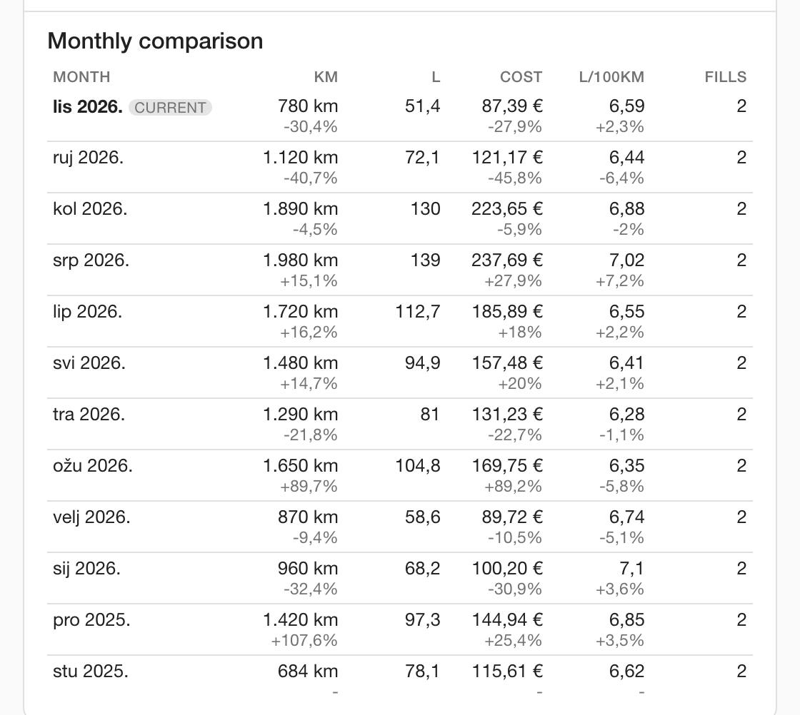
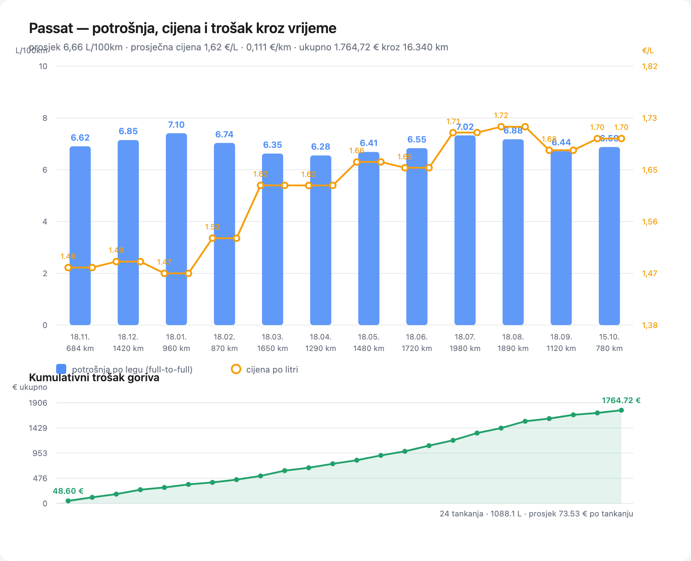

# Fuel Usage Tracker

A Home Assistant custom integration that tracks vehicle fuel consumption: how
much you paid, how many litres went in, what the car actually drinks per 100 km
and how far you drove. It ships its own Lovelace card, so the dashboard setup is
two clicks.

* Domain / entity prefix: **`fuelusagetracker`** — every entity id starts with
  `sensor.fuelusagetracker_`, so `entity_id: sensor.fuelusagetracker_*` fetches
  the whole fleet.
* One tracked vehicle = one config entry = one HA device (with its own sensors).
* Fill-ups are stored per vehicle in HA's own storage; no external database and
  no cloud.
* Languages: English and Croatian (`translations/`).

## Installation

### HACS (custom repository)

1. HACS → Integrations → ⋮ → *Custom repositories*.
2. Add `https://github.com/nix/ha_fuel_usage_tracker` as an *Integration*.
3. Install **Fuel Usage Tracker**, then restart Home Assistant.

### Manual

Copy `custom_components/fuelusagetracker/` into your Home Assistant
`config/custom_components/` directory and restart.

Requires Home Assistant 2026.2 or newer (tested with 2026.2.3, Python 3.13).

## Adding a vehicle

*Settings → Devices & services → Add integration → Fuel Usage Tracker.*

| Field | Meaning |
| --- | --- |
| Name | Vehicle name, e.g. `Passat`. Used in the device name and in every entity id. |
| Fuel type | Petrol, diesel, LPG, CNG, hybrid, electric, other. |
| Engine | Optional free text, e.g. `1.6 TDI`. |
| Odometer | Optional baseline odometer in km; makes "km since last fill-up" meaningful before the first fill-up. |

Add the integration again for every additional vehicle. Vehicle settings are
editable afterwards through the integration's *Configure* button.

## Recording a fill-up

The card (below) is the intended way, but the service is what everything else
uses — automations, scripts, and later the receipt OCR phase:

```yaml
service: fuelusagetracker.add_fillup
data:
  vehicle: Passat          # vehicle name or config entry id
  liters: 45.2
  price: 68.90             # TOTAL paid for this fill-up, not the price per litre
  odometer: 128450         # optional, km
  full: true               # full tank (default); needed for consumption maths
  station: "INA Šibenik"   # optional
  notes: "Autocesta"       # optional
```

Other services:

| Service | Fields |
| --- | --- |
| `fuelusagetracker.update_fillup` | `vehicle`, `fillup_id` + any of `liters`, `price`, `odometer`, `date`, `full`, `station`, `notes` |
| `fuelusagetracker.delete_fillup` | `vehicle`, `fillup_id` (the card confirms before deleting) |
| `fuelusagetracker.update_vehicle` | `vehicle` + any of `name`, `fuel_type`, `engine`, `odometer` |

Consumption uses the classic **tank-to-tank method**: a measured leg runs from
one full-tank fill-up with an odometer reading to the next one, and counts every
litre added in between — partial fill-ups included. A full-tank fill-up without
an odometer reading breaks the chain, because the distance driven is unknown.

## Sensors

For a vehicle named `Passat` (device `fuelusagetracker Passat`):

| Entity id | Meaning |
| --- | --- |
| `sensor.fuelusagetracker_passat_odometer` | Last known odometer (km) |
| `sensor.fuelusagetracker_passat_distance_since_last_fill_up` | km driven since the last fill-up with an odometer |
| `sensor.fuelusagetracker_passat_total_distance` | km between the first and the last odometer reading |
| `sensor.fuelusagetracker_passat_total_liters` | Total litres refuelled |
| `sensor.fuelusagetracker_passat_total_cost` | Total fuel cost |
| `sensor.fuelusagetracker_passat_average_price_per_liter` | Average price per litre |
| `sensor.fuelusagetracker_passat_last_fill_up` | Timestamp of the newest fill-up (+ fill-up list attribute) |
| `sensor.fuelusagetracker_passat_last_fill_up_cost` | Cost of the newest fill-up |
| `sensor.fuelusagetracker_passat_last_fill_up_liters` | Litres of the newest fill-up |
| `sensor.fuelusagetracker_passat_last_price_per_liter` | Price per litre of the newest fill-up |
| `sensor.fuelusagetracker_passat_last_consumption` | L/100 km, most recent measured leg |
| `sensor.fuelusagetracker_passat_average_consumption` | L/100 km, full-to-full average |
| `sensor.fuelusagetracker_passat_cost_per_km` | Fuel cost per km |
| `sensor.fuelusagetracker_passat_fill_up_count` | Number of recorded fill-ups |
| `sensor.fuelusagetracker_passat_distance_this_month` | km driven this month (tank-to-tank legs closed) |
| `sensor.fuelusagetracker_passat_litres_this_month` | Litres bought this month |
| `sensor.fuelusagetracker_passat_cost_this_month` | Fuel cost this month |
| `sensor.fuelusagetracker_passat_average_consumption_this_month` | L/100 km this month |
| `sensor.fuelusagetracker_passat_fill_ups_this_month` | Fill-ups this month |

19 sensors per vehicle. These ids are what Home Assistant generates for a
vehicle named `Passat` in an English UI; the prefix `sensor.fuelusagetracker_`
is always the same. Entity ids are only created once, so renaming the vehicle
afterwards keeps the existing ids (and the card never depends on them — it reads
the `key` attribute). Prefer `key` attributes or entity ids over hard-coded slugs
in your automations.

`total_cost` and `total_liters` use the `total` state class, `odometer` and
`total_distance` are `total_increasing`, so all four feed Home Assistant's
long-term statistics. The `month_*` sensors deliberately carry no state class:
they reset every month, so putting them into long-term statistics would corrupt
the sum. Every entity carries `key`, `vehicle`, `vehicle_name`, `fuel_type` and
`engine` attributes — the card and your automations can find things without
hard-coding entity ids.

## Monthly statistics

Every vehicle gets the five `*_this_month` sensors above plus a month-by-month
history for comparison. A month is bucketed by the fill-up date in your Home
Assistant time zone, so a 00:30 fill-up belongs to the day and month you
experienced.

* `litres`, `cost` and `fill-ups` are what you **bought** that month.
* `km` and `L/100 km` come from the tank-to-tank legs **closed** in that month
  (the leg's litres over the leg's kilometres). A month that closes no leg
  reports `unknown` — never a made-up number.
* Months without a fill-up are omitted instead of shown as zero.

For automations and dashboards, the `cost_this_month` sensor carries a `months`
attribute with the newest-first history (up to 24 months), and the card renders
it as a comparison table with the change against the previous month:



If you prefer Home Assistant's own monthly statistics entities, three helper
lines do the same job natively:

```yaml
utility_meter:
  passat_gorivo_mjesecno:
    source: sensor.fuelusagetracker_passat_total_cost
    cycle: monthly
  passat_litre_mjesecno:
    source: sensor.fuelusagetracker_passat_total_liters
    cycle: monthly
  passat_km_mjesecno:
    source: sensor.fuelusagetracker_passat_total_distance
    cycle: monthly
```

## The card

The integration registers `fuelusagetracker-card` automatically as a frontend
resource; after a browser refresh it appears in the card picker (*Add card →
Fuel Usage Tracker*).

```yaml
type: custom:fuelusagetracker-card
entity: sensor.fuelusagetracker_passat_total_cost   # optional
# vehicle: Passat                                    # or select by name / entry id
```

Without configuration the card shows the first tracked vehicle and offers a
picker for the rest. It shows the current statistics and the current month,
compares the last months side by side (km, litres, cost, L/100 km and the change
against the previous month), records fill-ups (date, litres, total price,
optional odometer, full tank, station), updates the odometer, and lists the
50 most recent fill-ups with delete (confirmation dialog).

## What it looks like

The card on a dashboard (real data: 24 fill-ups of a diesel Passat over twelve
months; the monthly comparison table sits below the tiles):


Month by month: fuel cost (bars, with the change against the previous month),
average consumption (line) and kilometres driven — this is the comparison the
card shows as a table too:


Consumption per measured full-to-full leg, price per litre and cumulative spend:



How the pieces are wired, and where the phase 2 receipt OCR will plug in:


All five images are reproducible: `docs/preview/card-preview.html` renders the
real card file against an exported state file, and
`docs/preview/make_diagrams.py` draws the charts and the diagram from the same
export using the integration's own aggregation code. Each file documents the
exact headless-Chrome command in its header.

## Roadmap

* **Phase 2 — receipt OCR.** Photograph a fuel receipt, OCR it, and feed the
  extracted date/price/litres into the very same `add_fillup` service. Nothing
  in the storage or service layer has to change for this.

## Development

```bash
python3.13 -m venv .venv
.venv/bin/pip install -r requirements_test.txt
.venv/bin/python -m pytest -q
```

Architecture and the frozen internal contract: [docs/ARCHITECTURE.md](docs/ARCHITECTURE.md).
Versioning is semantic (`manifest.json` + git tags) with the history in
[CHANGELOG.md](CHANGELOG.md).

## License

MIT
