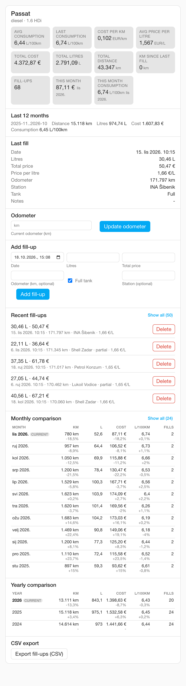
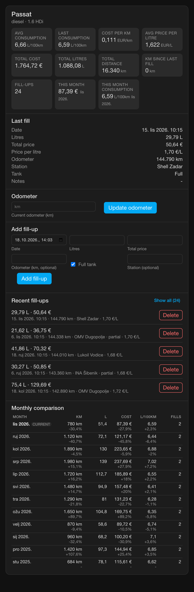
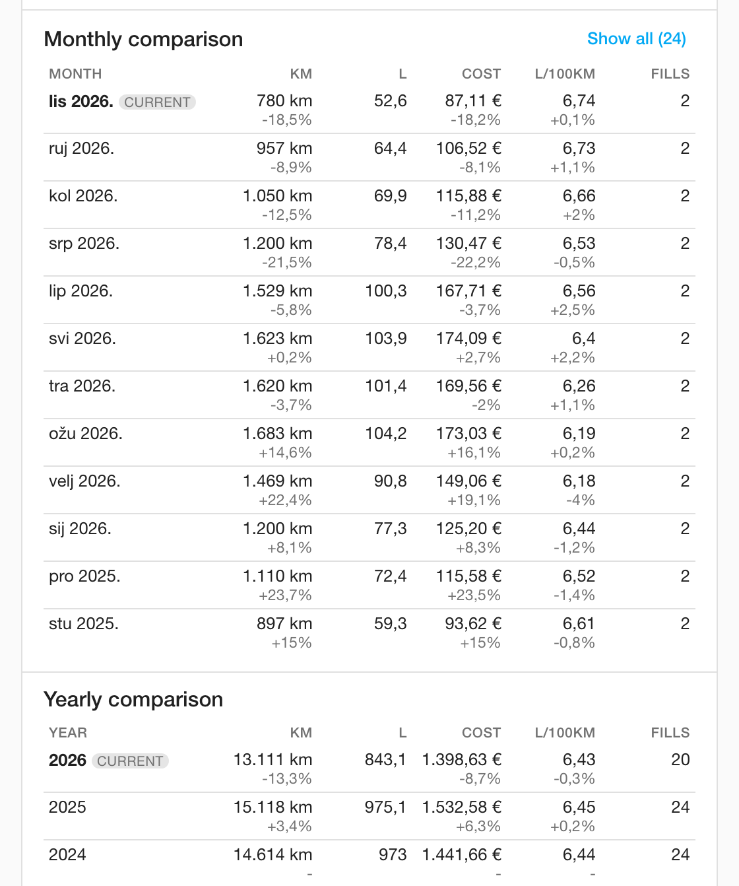
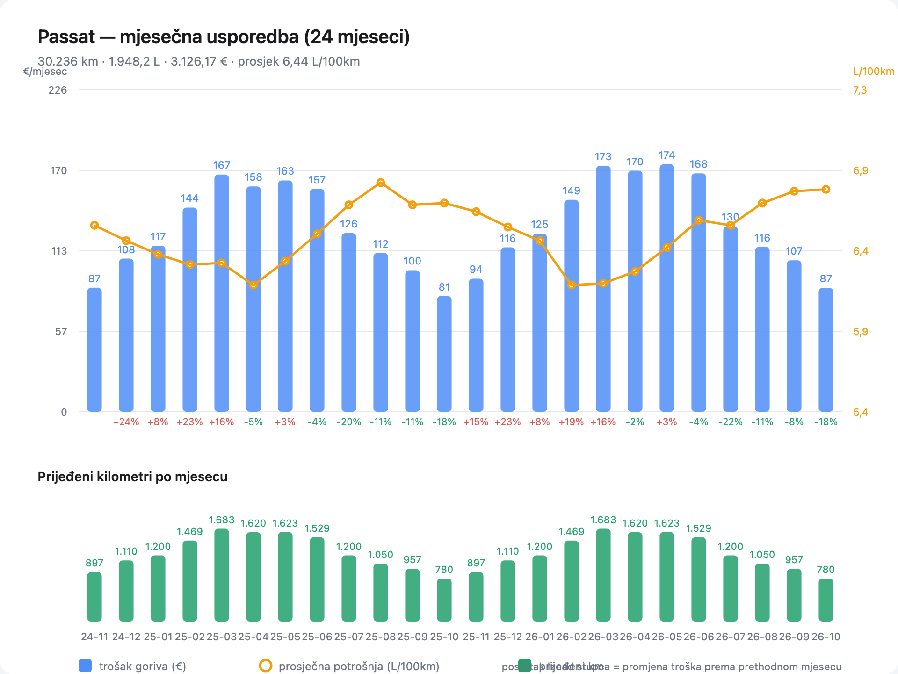
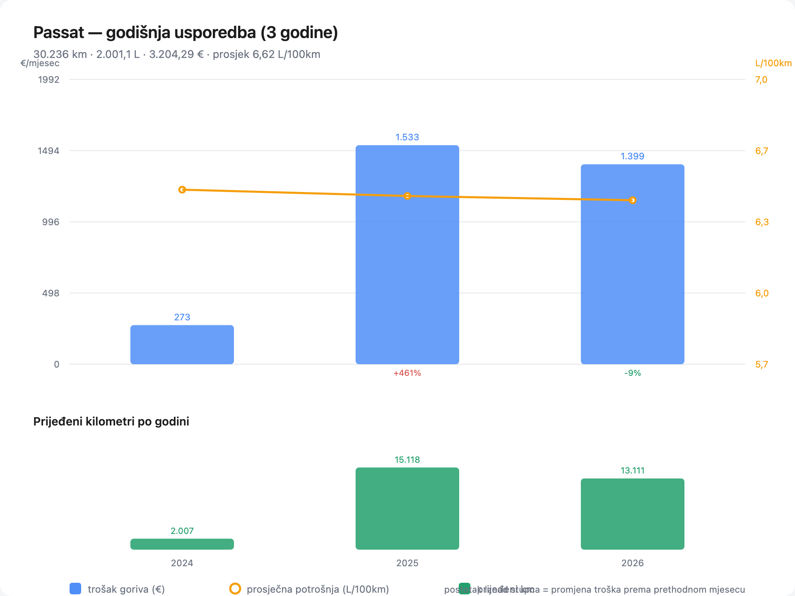
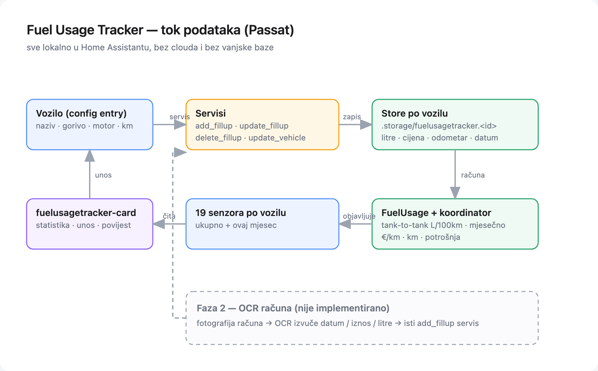

# Fuel Usage Tracker

A Home Assistant custom integration that tracks vehicle fuel consumption: how
much you paid, how many litres went in, what the car actually drinks per 100 km
and how far you drove. It ships its own Lovelace card, so the dashboard setup is
two clicks.

* Domain / entity prefix: **`fuelusagetracker`** — every entity id starts with
  `sensor.fuelusagetracker_`, so `entity_id: sensor.fuelusagetracker_*` fetches
  the whole fleet.
* One tracked vehicle = one config entry = one HA device (with its own sensors).
* Fill-ups are stored per vehicle in HA's own storage; no external database and
  no cloud.
* Languages: English and Croatian (`translations/`).

## Installation

### HACS (custom repository)

1. HACS → Integrations → ⋮ → *Custom repositories*.
2. Add `https://github.com/ngarafol/ha_fuel_usage_tracker` as an *Integration*.
3. Install **Fuel Usage Tracker**, then restart Home Assistant.

### Manual

Copy `custom_components/fuelusagetracker/` into your Home Assistant
`config/custom_components/` directory and restart.

Requires Home Assistant 2026.2 or newer (tested with 2026.2.3, Python 3.13).

## Adding a vehicle

*Settings → Devices & services → Add integration → Fuel Usage Tracker.*

| Field | Meaning |
| --- | --- |
| Name | Vehicle name, e.g. `Passat`. Used in the device name and in every entity id. |
| Fuel type | Petrol, diesel, LPG, CNG, hybrid, electric, other. |
| Engine | Optional free text, e.g. `1.6 TDI`. |
| Odometer | Optional baseline odometer in km; makes "km since last fill-up" meaningful before the first fill-up. |

Add the integration again for every additional vehicle. Vehicle settings are
editable afterwards — open the integration entry's ⋮ menu and pick
**Reconfigure**, which re-runs this same wizard prefilled with the current
values. Saving updates the entry data and the vehicle name (the device name and
the `vehicle_name` attribute follow it); existing entity ids keep their original
slugs, because Home Assistant generates them only once.

## Recording a fill-up

The card (below) is the intended way, but the service is what everything else
uses — automations, scripts, and later the receipt OCR phase:

```yaml
service: fuelusagetracker.add_fillup
data:
  vehicle: Passat          # vehicle name or config entry id
  liters: 45.2
  price: 68.90             # TOTAL paid for this fill-up, not the price per litre
  odometer: 128450         # optional, km
  full: true               # full tank (default); needed for consumption maths
  station: "INA Šibenik"   # optional
  notes: "Autocesta"       # optional
```

Other services:

| Service | Fields |
| --- | --- |
| `fuelusagetracker.delete_fillup` | `vehicle`, `fillup_id` (the card confirms before deleting) |
| `fuelusagetracker.update_vehicle` | `vehicle` + any of `name`, `fuel_type`, `engine`, `odometer` |
| `fuelusagetracker.export_csv` | `vehicle`, `scope` (`fillups` \| `months` \| `years`), `filename` — see [CSV export](#csv-export) |

Consumption uses the classic **tank-to-tank method**: a measured leg runs from
one full-tank fill-up with an odometer reading to the next one, and counts every
litre added in between — partial fill-ups included. A full-tank fill-up without
an odometer reading breaks the chain, because the distance driven is unknown.

## Sensors

For a vehicle named `Passat` (device `fuelusagetracker Passat`):

| Entity id | Meaning |
| --- | --- |
| `sensor.fuelusagetracker_passat_odometer` | Last known odometer (km) |
| `sensor.fuelusagetracker_passat_distance_since_last_fill_up` | km driven since the last fill-up with an odometer |
| `sensor.fuelusagetracker_passat_total_distance` | km between the first and the last odometer reading |
| `sensor.fuelusagetracker_passat_total_liters` | Total litres refuelled |
| `sensor.fuelusagetracker_passat_total_cost` | Total fuel cost |
| `sensor.fuelusagetracker_passat_average_price_per_liter` | Average price per litre |
| `sensor.fuelusagetracker_passat_last_fill_up` | Timestamp of the newest fill-up (+ fill-up list attribute) |
| `sensor.fuelusagetracker_passat_last_fill_up_cost` | Cost of the newest fill-up |
| `sensor.fuelusagetracker_passat_last_fill_up_liters` | Litres of the newest fill-up |
| `sensor.fuelusagetracker_passat_last_price_per_liter` | Price per litre of the newest fill-up |
| `sensor.fuelusagetracker_passat_last_consumption` | L/100 km, most recent measured leg |
| `sensor.fuelusagetracker_passat_average_consumption` | L/100 km, full-to-full average |
| `sensor.fuelusagetracker_passat_cost_per_km` | Fuel cost per km |
| `sensor.fuelusagetracker_passat_fill_up_count` | Number of recorded fill-ups |
| `sensor.fuelusagetracker_passat_{distance,litres,cost,average_consumption,fill_ups}_this_month` | this month: km, litres bought, fuel cost, L/100 km, fill-ups |
| `sensor.fuelusagetracker_passat_{distance,litres,cost,average_consumption}_last_12_months` | trailing 12 months (never resets on 1 January; the `window` attribute carries the exact range) |
| `sensor.fuelusagetracker_passat_{distance,litres,cost,average_consumption}_this_year` | this calendar year (`cost_this_year` also carries the 10-year `years` history) |

27 sensors per vehicle — the braces are a shorthand for the five/four generated
ids, e.g. `sensor.fuelusagetracker_passat_distance_this_month`. The
device/state class and unit of every key are in
[docs/ARCHITECTURE.md](docs/ARCHITECTURE.md#entities).

These ids are what Home Assistant generates for a
vehicle named `Passat` in an English UI; the prefix `sensor.fuelusagetracker_`
is always the same. Entity ids are only created once, so renaming the vehicle
afterwards keeps the existing ids (and the card never depends on them — it reads
the `key` attribute). Prefer `key` attributes or entity ids over hard-coded slugs
in your automations.

`total_cost` and `total_liters` use the `total` state class, `odometer` and
`total_distance` are `total_increasing`, so all four feed Home Assistant's
long-term statistics. The `month_*` sensors deliberately carry no state class:
they reset every month, so putting them into long-term statistics would corrupt
the sum. Every entity carries `key`, `vehicle`, `vehicle_name`, `fuel_type` and
`engine` attributes — the card and your automations can find things without
hard-coding entity ids.

## Period statistics: month, year, rolling 12 months

Every vehicle gets three period views, all computed with the same rules:

* **This month** (`*_this_month`) — five sensors plus the `months` history on
  `cost_this_month`, which the card renders as a monthly comparison table;
* **This year** (`*_this_year`) — km, litres, cost and L/100 km for the current
  calendar year, plus a year-on-year comparison table from the `years` history
  on `cost_this_year` (10 years kept);
* **Trailing 12 months** (`*_last_12_months`) — a rolling window that always ends
  today, so it never resets on the 1st of January. The `window` attribute on
  those sensors carries the exact range (e.g. `2025-11..2026-10`), including the
  current, possibly incomplete month.

A period is bucketed by the fill-up date in your Home Assistant time zone. In
every case `litres`, `cost` and `fill-ups` are what you **bought**, while `km`
and `L/100 km` come from the tank-to-tank legs **closed** in that period — a
period that closes no leg reports `unknown` instead of a made-up number, and
periods without any fill-up are simply absent.

The `month_*`, `year_*` and `rolling_*` totals deliberately have no state class:
those values reset or slide, so feeding them into long-term statistics would
corrupt the sum. Only the `*_avg_consumption` of each period is a measurement.
For Home Assistant's own period statistics, three helper lines do the job
natively:

```yaml
utility_meter:
  passat_gorivo_mjesecno:
    source: sensor.fuelusagetracker_passat_total_cost
    cycle: monthly
  passat_litre_mjesecno:
    source: sensor.fuelusagetracker_passat_total_liters
    cycle: monthly
  passat_km_mjesecno:
    source: sensor.fuelusagetracker_passat_total_distance
    cycle: monthly
```

## CSV export

```yaml
service: fuelusagetracker.export_csv
data:
  vehicle: Passat            # or the config entry id
  scope: fillups             # fillups (default) | months | years
  format: standard           # standard (default) | excel_hr
  filename: passat.csv       # optional; a plain .csv name, no directories
```

The service writes UTF-8 (with BOM, so Excel reads Croatian station names) into
your Home Assistant config directory — default
`fuelusagetracker_passat_fillups.csv` — and returns `{"path": ..., "rows": ...}`:

| `format` | Fields | Decimals | Line endings | Use it for |
| --- | --- | --- | --- | --- |
| `standard` | `,` | `1.470` | LF | scripts, pandas, git-friendly diffs |
| `excel_hr` | `;` | `1,470` | CRLF | Excel with a Croatian/European locale |

```yaml
- service: fuelusagetracker.export_csv
  data:
    vehicle: Passat
    scope: months
    format: excel_hr
  response_variable: izvoz
- service: notify.persistent_notification
  data:
    message: "{{ izvoz.rows }} redova -> {{ izvoz.path }}"
```

A `filename` containing a path separator, a parent reference or a leading dot is
rejected, so an export can never escape the config directory. The card also has
an **Export CSV** button that calls the service for the selected vehicle.

### Scheduled export

Scheduling is Home Assistant's job, not the integration's: trigger the service
from an automation and let any `notify` target deliver the file. Service data is
templated, so the file name can carry the period:

```yaml
automation:
  - alias: "Fuel: monthly CSV export"
    triggers:
      - trigger: time
        at: "08:00:00"
    conditions:
      - condition: template
        value_template: "{{ now().day == 1 }}"
    actions:
      - service: fuelusagetracker.export_csv
        data:
          vehicle: Passat
          scope: months
          format: excel_hr
          filename: "passat_gorivo_{{ now().strftime('%Y-%m') }}.csv"
        response_variable: izvoz
      - service: notify.persistent_notification
        data:
          title: "Fuel CSV"
          message: "{{ izvoz.rows }} rows written to {{ izvoz.path }}"
```

For notification platforms that support attachments, pass the returned
`izvoz.path` in that platform's attachment field (the key differs per platform,
so check your `notify` target's docs).

## The card

The integration registers `fuelusagetracker-card` automatically as a frontend
resource; after a browser refresh it appears in the card picker (*Add card →
Fuel Usage Tracker*).

```yaml
type: custom:fuelusagetracker-card
entity: sensor.fuelusagetracker_passat_total_cost   # optional
# vehicle: Passat                                    # or select by name / entry id
```

Without configuration the card shows the first tracked vehicle and offers a
picker for the rest. It shows the current statistics, the current month and the
current year (cost and consumption tiles), a rolling last-12-months summary,
monthly **and** yearly comparison tables (km, litres, cost, L/100 km and the
change against the previous period), records fill-ups (date, litres, total
price, optional odometer, full tank, station), updates the odometer, exports the
fill-up log to CSV, and lists the 50 most recent fill-ups with delete
(confirmation dialog).

### Missing card in the companion app

The mobile apps cache the frontend, so a card that renders in a browser can still
be missing in the app with *"Custom element doesn't exist:
fuelusagetracker-card"*. The integration registers the card twice — as a
frontend module and as a dashboard resource — and the resource path survives a
stale app shell, so check these in order:

1. Update the integration and **restart Home Assistant** (the module URL lives in
   the running process).
2. **Settings → Dashboards → ⋮ → Resources** must list
   `/fuelusagetracker/fuelusagetracker-card.js?v=…` (type *JavaScript module*).
   The log line `Registered the fuelusagetracker card as a dashboard resource`
   confirms it; a warning there names the manual step when Lovelace runs in YAML
   resource mode.
3. In the app: **Settings → Companion app → Debugging → Reset frontend cache**,
   then force-close and reopen. This is the documented fix for app-only custom
   card failures ([home-assistant/iOS#3315](https://github.com/home-assistant/iOS/issues/3315)).
4. If it still fails, open the same dashboard in the phone's browser: working
   there but not in the app means the app's WebView storage is stale —
   reinstalling the app clears it.

## What it looks like

The card on a dashboard (real data: a diesel Passat over almost three years;
the rolling summary, the monthly table and the yearly table sit below the tiles):





The comparison tables in detail — one renderer, one row per period, deltas
against the previous period (the yearly table below the monthly one):



Month by month: fuel cost (bars, with the change against the previous month),
average consumption (line) and kilometres driven:



Year by year, the same layout (this is also the "review the year" view):



How the pieces are wired, and where the phase 2 receipt OCR will plug in:



All six images are reproducible: `docs/preview/card-preview.html` renders the
real card file against an exported state file, and
`docs/preview/make_diagrams.py` draws the charts and the diagram from the same
export using the integration's own aggregation code. Each file documents the
exact headless-Chrome command in its header.

## Roadmap

* **Phase 2 — receipt OCR.** Photograph a fuel receipt, OCR it, and feed the
  extracted date/price/litres into the very same `add_fillup` service. Nothing
  in the storage or service layer has to change for this.

## Development

```bash
python3.13 -m venv .venv
.venv/bin/pip install -r requirements_test.txt
.venv/bin/python -m pytest -q
```

Architecture and the frozen internal contract: [docs/ARCHITECTURE.md](docs/ARCHITECTURE.md).
Versioning is semantic (`manifest.json` + git tags) with the history in
[CHANGELOG.md](CHANGELOG.md).

### Releases

`manifest.json` is the source of truth for the version. Add the `## [x.y.z]`
section to [CHANGELOG.md](CHANGELOG.md), then release with one command:

```bash
scripts/release.sh 0.6.5     # bumps manifest.json, commits, tags and pushes
```

The script refuses to run when the CHANGELOG section is missing or the working
tree has unrelated changes, so the tag can never disagree with `manifest.json`.
`.github/workflows/release.yml` then creates the GitHub Release with that
CHANGELOG section as its notes (it fails the run on a mismatch and never
recreates an existing release).

Enable the local pre-push guard once per clone — it blocks a `v*` tag whose
commit carries another version, before it reaches GitHub:

```bash
git config core.hooksPath .githooks
```

Tags that predate the workflow can be released from the Actions tab
(*Release → Run workflow → enter the tag*).

## License

MIT
